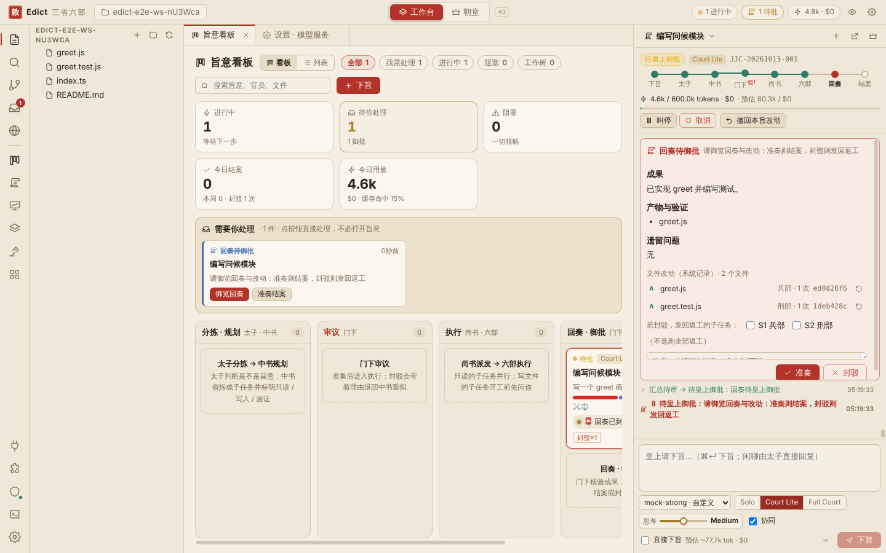
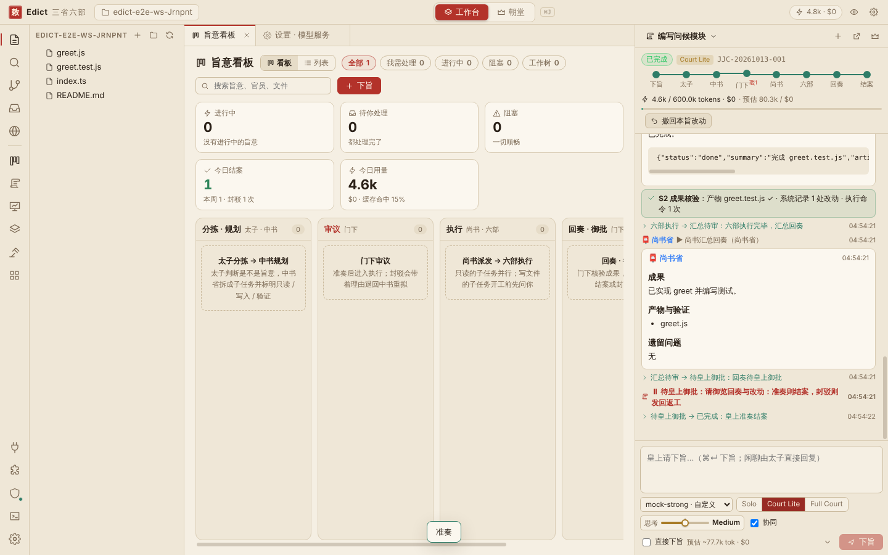
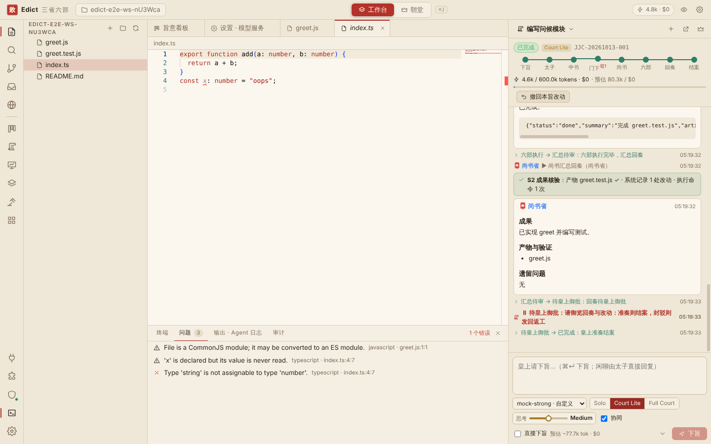
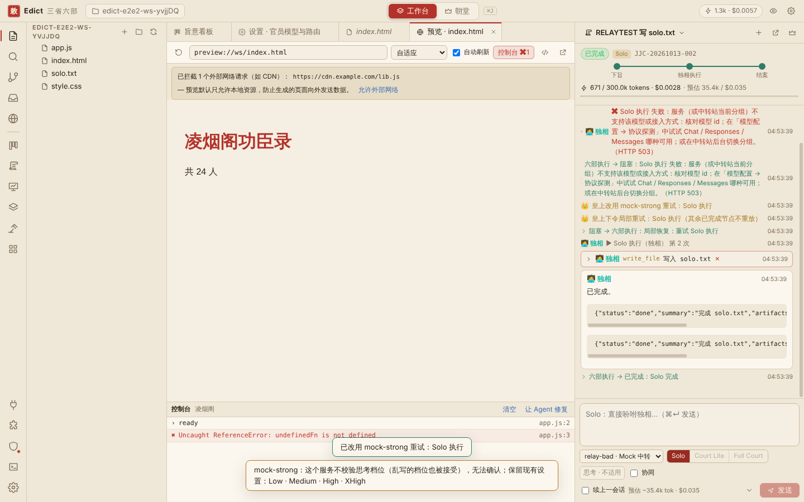
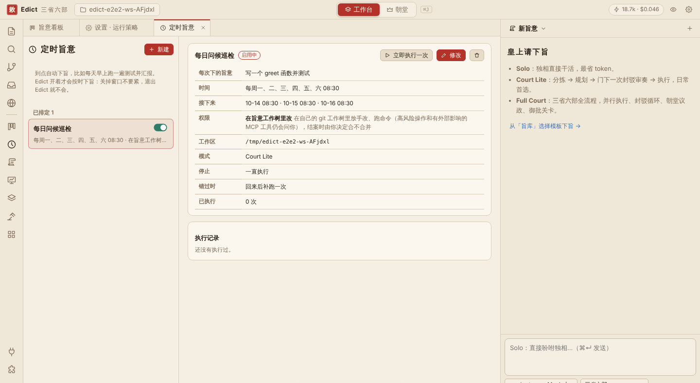
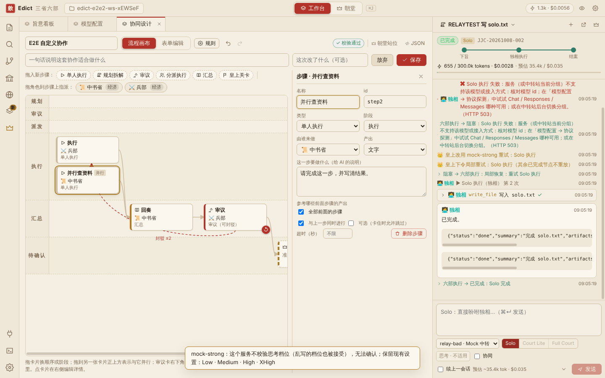
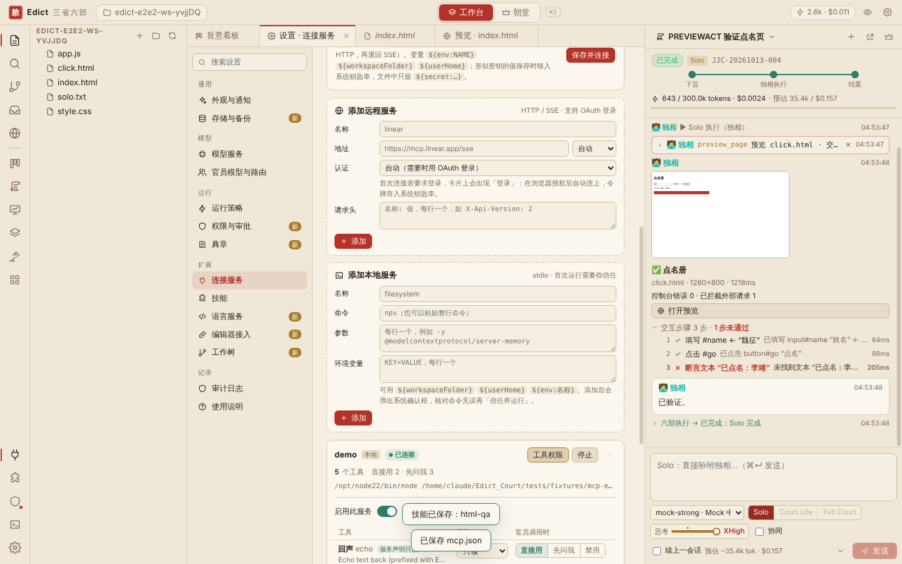
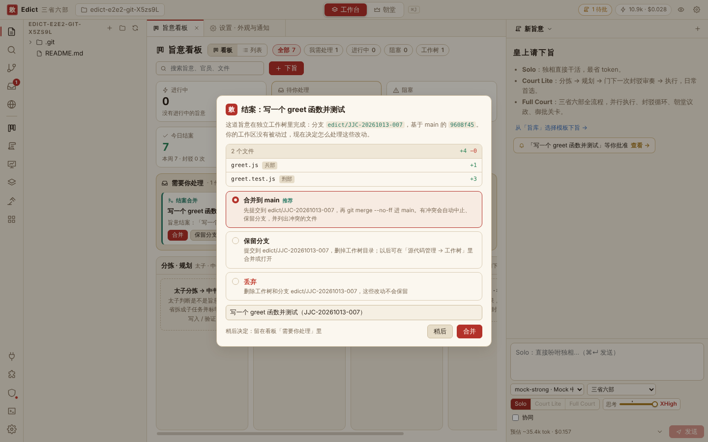
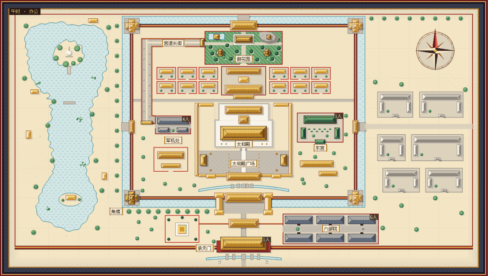
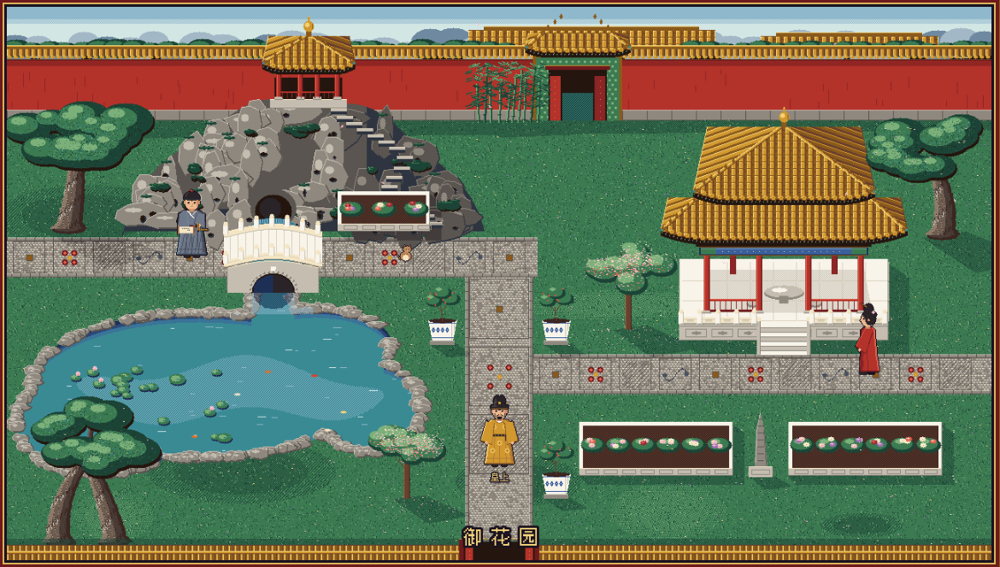

# Edict - A Multi-Agent Collaborative Programming Workstation

English | [Chinese (Simplified)](README.zh-CN.md)

<p align="center">
  <a href="https://github.com/Logosss1/Edict_Court/releases/latest"></a>
  
  
  <a href="LICENSE"></a>
</p>

Edict for Mac is a desktop AI coding workstation for **Apple Silicon Macs**. You issue an order, an *edict*, and a court of AI officials handles it the way an imperial court would: the Crown Prince triages it, the Secretariat plans it, the Chancellery reviews the plan, and the Six Ministries carry it out in parallel and report back for your approval. The workflow comes from [EDICT](https://github.com/cft0808/edict)'s Three Departments and Six Ministries.

```
You issue an edict → Crown Prince triages → Secretariat plans → Chancellery reviews (approve or send back)
  → Department of State Affairs dispatches → Six Ministries work in parallel → report → you approve
```

| Workbench | Court |
|---|---|
|  |  |

The workbench and the court are two views of the same live state. Approve in the court and the workbench closes the case; stop an official in the workbench and the same official stops writing in the court. Switch with ⌘J.

## Main features

### A court of agents, three ways to work

| Tier | Flow | Use for |
|---|---|---|
| **Solo** | One agent talks to you, reads and writes files, runs commands | Quick tasks |
| **Court Lite** (default) | Triage → plan → review → ministries → report | Everyday work |
| **Full Court** | The whole court, with an optional debate, an optional plan review where you can edit the plan before it is released, parallel ministries with a dependency graph, and a check of the results | Large, long tasks |

The Chancellery cannot be bypassed: there is no path from planning to execution that skips its review, and a plan it sends back must be reworked. Its notes are marked *must fix* or *suggestion*, and only a must-fix can send the work back; a second round checks only the last round's must-fix items.

### You stay in charge

- Subtasks are read, write or verify. Read subtasks run side by side; each write subtask asks before it starts, and you can allow it, allow it without further questions, keep it read-only, or reject it.
- Approvals can be remembered for one edict or permanently for a workspace. High-risk actions always ask, and release or deploy commands ask every time unless the workspace opts in.
- When something is unclear, officials stop and ask you, with options to pick from.
- While an edict is running you can send it a correction from the input box, an *oral order*. The official at work reads it on the next step, and the later reviews and checks follow it too.
- Each mode has a token budget, and 0 means no limit. When an edict reaches its budget it waits for you: raise the budget by half, lift the limit for that edict so it runs to the end, or cancel it.
- When an edict is blocked, *See why* opens a window with the cause, each failed step, how to fix it, and buttons that do it.
- Results are checked against the changes Edict actually recorded, and any step or a whole edict can be reverted, including changes made by shell commands.
- Officials' shell commands run in a macOS sandbox: they can write only to the workspace (or the edict's worktree), temporary folders and package caches, and cannot read the folders that hold keys, tokens and browser data. Network access is on by default and can be turned off. When the sandbox blocks a command, a card lets you run it once without the sandbox, allow that folder for the workspace, or stop.

### A full coding workbench

A file tree, Monaco editor with diagnostics, project-wide search and replace, an integrated terminal, a problems panel and Git. Edict uses the language servers already installed on your Mac. A sandboxed preview runs generated web pages, and officials test their own pages in it. The Kanban board has a lane for everything waiting on you. The edict pane on the right can be collapsed to a thin bar (⌘⌥B) that still shows how many things wait on you.

| Kanban | Editor | Web preview |
|---|---|---|
|  |  |  |

### One git worktree per edict

In a git repository each edict works on its own branch in its own folder, so several edicts on one repository run side by side and your own checkout is not touched. When an edict is done you see every changed file and who changed it, then merge, keep the branch, or discard it.

Each new worktree can be prepared before the officials start: untracked files such as `.env` are copied in, dependency folders are linked, and a setup script of your choice runs. Every worktree also gets its own block of ports (`$EDICT_PORT`), so edicts that start dev servers side by side don't collide.

### Requirements, checked at the end

The Secretariat starts each plan with a short requirement spec: the goal, numbered acceptance criteria, what is out of scope, and constraints. Each subtask says which criteria it delivers. When the ministries are done, the Chancellery checks every criterion and gives a verdict with evidence; anything unmet goes back to the ministry for another round, and if it is still unmet the edict waits for your decision. You can read and edit the spec on the plan, and the final report lists the check. On by default in Court Lite and Full Court.

The court stays true to the edict. The Secretariat may not change what the edict is mainly about, word counts are targets rather than exact numbers (within about 15%), and the final check compares the finished work with the edict, not the paperwork along the way. Small differences that break no hard requirement are listed in the report under *differences from the edict* instead of being reworked.

### Scheduled edicts

Set an edict to run on its own: daily, on chosen weekdays, every few hours, at morning court or once. Each schedule has its own folder, mode and model, and you decide up front what it may do: read only, ask before every change, or work freely inside its own git worktree and leave the merge to you. A run missed while the Mac was asleep runs once when Edict is back. Officials can also propose a schedule; it waits for your approval.

### Other coding agents, and several attempts at once

- **Outside agents as officials.** Coding agents installed on your Mac that speak ACP can take on a ministry's subtask. They work only in the edict's worktree, their file and command requests go through Edict's permissions and sandbox, and files they change with their own tools are recorded and can be reverted. If an agent can't start or isn't logged in, the ministry's own official takes over. Pick an agent per ministry in Settings › Outside agents, or per subtask on the plan. Edict only uses agents you have already installed and logged in to.
- **Several attempts at one subtask.** For a hard write subtask you can assign two or three lanes when you review the plan, each done by an official (with any model) or an outside agent. The lanes work side by side in their own worktrees, the Chancellery scores them, and you compare their changes, scores, time and cost side by side and pick one to merge. The others can be kept as branches. Available in Full Court, and in Court Lite when you turn it on.

| Comparing lanes | A scheduled edict | Requirement check |
|---|---|---|
|  |  |  |

### Models, skills and tools

- Officials can read web pages, and search the web through a search service you set up or the model's own web search. If an edict needs search and none is set up, the official asks you and the setup opens right there.
- OpenAI Chat Completions, OpenAI Responses and Anthropic Messages, with any compatible service. No keys are built in; yours are encrypted with a key kept in the macOS keychain.
- Strong and economy models, and a model of your choice for each official. The Models page shows one card per model; prices stay hidden unless you choose to enter them.
- A thinking slider with the same six steps for every model: none, light, medium, high, extra high and max. Steps a model lacks are greyed out and skipped, and the way each step maps to the model's own levels is detected from the model and can be changed.
- Response settings (temperature, top-p, frequency and presence penalties) for each model and each official. An official's own settings win over the model's.
- 37 built-in skills for planning, review, investigation, QA, release and deploy, plus your own.
- MCP servers (stdio, Streamable HTTP, SSE) with OAuth login, resources and prompts, and per-tool risk levels. Editors that speak ACP can drive Edict too.

| Collaboration designs | MCP servers | Merging a worktree |
|---|---|---|
|  |  |  |

### Your own collaboration designs

The court's flow is a versioned design. Copy it, rearrange the steps on a flow canvas, decide where a rejection sends the work, give each role its own model, and pin a design to an edict.

### Auditable and recoverable

Every action goes into a hash-chained audit log. Each step is saved as it finishes, so after a failure or a restart only the failed step runs again. Your data lives in one SQLite database.

## Standout features

### A living palace

The court mode is a pixel-art palace that runs on your Mac's clock and acts out the work as it happens.

- **A palace day.** Morning court opens by itself between 6 and 9. During the day officials work in their own offices, in the evening they leave one by one, and at night the halls stand empty under the lamps. You can call court at any time by striking the drum at the gate; an idle court ends after a few minutes.
- **The work, acted out.** Officials carry memorials between offices, runners take messages from hall to hall, rejected plans come back stamped, and an official who needs your decision walks to wherever you are and kneels to ask. Busy ministries are excused from court and keep working at their desks.
- **Walk the palace.** Ten scenes: the Hall of Supreme Harmony, the Palace Square, Chengtian Gate, the Privy Council with its memorial wall, the Six Ministries Office, the Eastern Palace, the Imperial Garden, the Long Palace Street, the Corner Tower and a palace map. Walk with the arrow keys or click, and officials bow as you pass.
- **Small things.** The real phase of the moon, weather, falling petals in spring, fireflies on summer nights, fireworks on festival nights, a palace cat, and koi in the garden pond that come when you feed them.

| Court in session | A report presented | Palace map |
|---|---|---|
|  |  |  |
| **Six Ministries Office** | **Privy Council** | **Chengtian Gate** |
|  |  |  |
| **Eastern Palace** | **Imperial Garden** | **Corner Tower at night** |
|  |  |  |

### The planning official asks before planning

Before the first plan, the official who plans (the Secretariat, or the planning role in your own design) asks you about the edict in rounds. Each question comes with a recommended answer, and questions that depend on an earlier answer wait until it is given; there is no limit on rounds, and you can tell it to stop and plan at any time. What the official can look up itself (files, code, web pages) is not asked: it is listed as facts it found, and each one is used only after you confirm it. The questions and answers end in a short summary that you confirm before work starts, and every later official works from it.

In full-auto mode nobody may be there to answer. Unanswered questions then go ahead on the recommended answer but stay open, and an answer you give later reaches the officials as an oral order, with the work done so far adjusted before the report. Solo and scheduled edicts don't ask; you can skip the questions for one edict, or turn them off in Settings › Permissions & approvals.

| A round of questions | The summary to confirm | An oral order |
|---|---|---|
|  |  |  |

## Recent updates

- **2.1.1**: the planning official asks before planning, review notes split into must-fix and suggestions, oral orders to a running edict, six fixed thinking steps, response settings per model and official, a *See why* window for blocked edicts, token budgets that can be unlimited, and an edict pane that collapses.
- **2.1.0**: web reading and search, a command sandbox, requirement specs checked at the end, scheduled edicts, outside coding agents as officials, several attempts at one subtask, and worktree setup with ports of their own.
- **2.0.3**: the living palace, ten new scenes, and the Crown Prince's clarifying question.
- **2.0**: execution you stay in charge of, one git worktree per edict, MCP login with resources and prompts, language servers, editors over ACP, built-in skills, SQLite storage and a new settings center.

The full history is in [RELEASE_NOTES.md](RELEASE_NOTES.md).

## Install

Download `Edict-<version>-arm64.dmg` from [Releases](https://github.com/Logosss1/Edict_Court/releases/latest) and drag Edict into Applications ([details](docs/INSTALL_MAC.md)). The app is not signed with a Developer ID or notarized, so on first launch allow it in System Settings → Privacy & Security → "Open Anyway". Apple Silicon only; there is no Intel build yet.

## Build from source

```bash
npm install
npm run build            # bundle main / preload / renderer into dist/
npx electron dist        # run
npm test                 # unit and integration tests (mock model)
npm run typecheck
npm run package:mac      # build Edict.app (arm64), sign ad hoc, make the zip and DMG
```

`package:mac` needs the official `electron-v44.4.5-darwin-arm64.zip` in `deps/` (or `ELECTRON_DARWIN_ZIP`). On macOS it signs with `codesign` and builds the DMG with `hdiutil`; on Linux it needs `rcodesign` and libdmg-hfsplus `dmg`. End-to-end tests: `npm run e2e` and `npm run e2e:features` after `npm run build` (Playwright; on Linux run them under `xvfb-run`, see [docs/TESTING.md](docs/TESTING.md)).

## Documentation (in Chinese)

[Status and limitations](docs/STATUS.md) · [Architecture](docs/ARCHITECTURE.md) · [Security](docs/SECURITY.md) · [Testing](docs/TESTING.md) · [Install](docs/INSTALL_MAC.md)

## License

MIT. Third-party components are listed in [THIRD_PARTY_NOTICES.md](THIRD_PARTY_NOTICES.md). EDICT and Yan-Agent are MIT-licensed.
